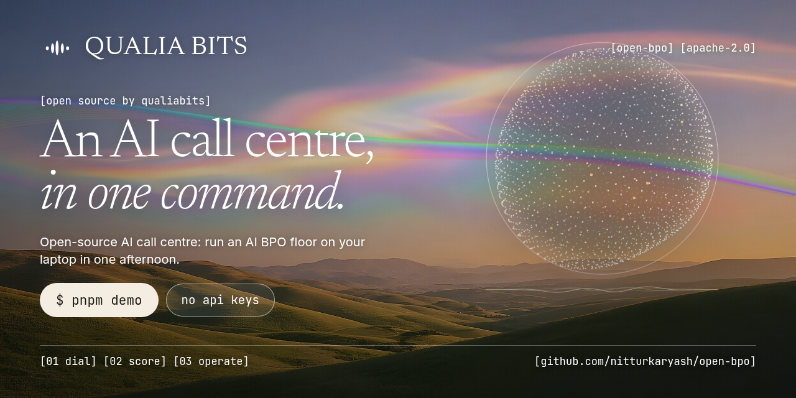
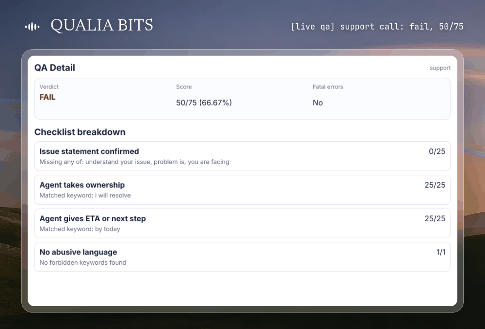
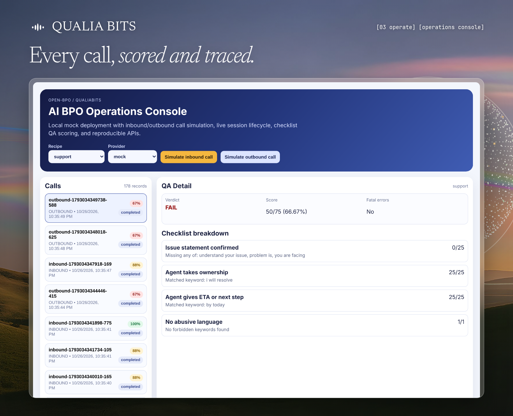
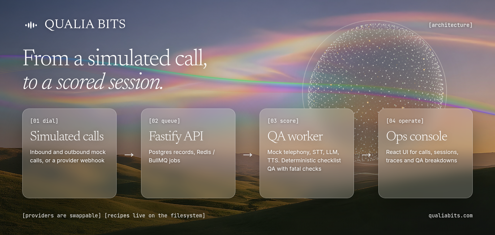
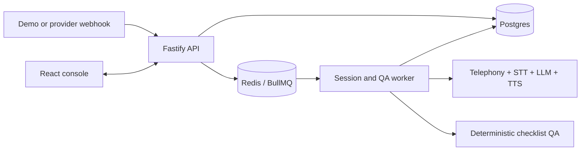

<p align="center">
  
</p>

<h3 align="center">Run an AI call centre on your laptop. Open source, no API keys.</h3>

<p align="center">
  <a href="#quickstart">Quickstart</a> ·
  <a href="docs/ARCHITECTURE.md">Architecture</a> ·
  <a href="docs/RECIPE_AUTHORING.md">Recipes</a> ·
  <a href="docs/API_REFERENCE.md">API</a> ·
  <a href="ROADMAP.md">Roadmap</a>
</p>

<p align="center">
  <a href="https://github.com/nitturkaryash/open-bpo/actions/workflows/ci.yml"></a>
  <a href="LICENSE"></a>
  <a href="https://github.com/nitturkaryash/open-bpo/stargazers"></a>
  <a href="CONTRIBUTING.md"></a>
</p>

<p align="center">
  
</p>

## Quickstart

Needs Node.js 20+ and pnpm 10.

```bash
git clone https://github.com/nitturkaryash/open-bpo.git && cd open-bpo
pnpm install
pnpm demo
```

Open [http://127.0.0.1:43123](http://127.0.0.1:43123). Simulated inbound and outbound calls stream into the console with session traces and QA scores. `Ctrl+C` stops everything.

## What you get

- [x] Inbound and outbound call simulation. [Quickstart](docs/QUICKSTART.md)
- [x] Deterministic QA: versioned checklists with fatal checks. Same call, same score. [Examples](docs/QA_CHECKLISTS.md)
- [x] Operations console for calls, sessions, traces and QA breakdowns
- [x] Swappable telephony, STT, TTS and LLM interfaces. [Provider guide](docs/PROVIDERS.md)
- [x] Recipes as folders: prompt, tools, QA policy. [Authoring guide](docs/RECIPE_AUTHORING.md)
  - [x] Lead qualification
  - [x] Support resolution
  - [x] Payment reminders
- [x] Fastify API and BullMQ workers on Postgres and Redis. [API reference](docs/API_REFERENCE.md)
- [ ] Real telephony and speech adapters (only mocks and stubs ship today, see [ROADMAP.md](ROADMAP.md))

<p align="center"></p>

## Why this exists

BPOs are moving to AI. Most of the work on a call floor is repetitive, and voice models are now good enough to do a lot of it.

The hard part isn't the model. It's everything around it: queues, session state, QA you can trust, and a console your team watches all day. If you rent all of that as a black box, you can't change how calls are scored or where your data goes.

So you need to own the stack. open-bpo is the smallest version of that stack we could make, small enough to read in an evening and run in an afternoon. It's built by the team at [QualiaBits](https://qualiabits.com).

**What it is not:** a hosted product, or something that places real phone calls out of the box. It's an early, readable scaffold you own and extend.

## How it works

- **API** (`apps/api`): Fastify server. Takes demo calls or provider webhooks, stores state in Postgres, enqueues work.
- **Worker** (`apps/worker`): BullMQ consumers that run each session loop and score it.
- **QA** (`packages/qa`): checklist schema and scorer. Pure and deterministic, so scores can be diffed.
- **Providers** (`packages/providers`): interfaces for telephony, STT, TTS and LLM, with mock adapters.
- **Console** (`apps/web`): React/Vite dashboard over the API.
- **Recipes** (`recipes/`): one folder per use case.

## Architecture





The provider boundary and runtime flows are described in [docs/ARCHITECTURE.md](docs/ARCHITECTURE.md).

## Container quickstart

For the Postgres and Redis-backed topology, use Docker with Compose and ports `4017`, `43123`, `55432`, and `56379` available.

```bash
git clone https://github.com/nitturkaryash/open-bpo.git
cd open-bpo
docker compose up --build
```

Open the console at [http://127.0.0.1:43123](http://127.0.0.1:43123), or create a call from another terminal:

```bash
curl -X POST http://127.0.0.1:4017/v1/demo/calls/inbound \
  -H "Content-Type: application/json" \
  -d '{"recipeId":"lead-qualification","provider":"mock","startSession":true}'
```

Run the complete API-to-QA smoke path with `./scripts/demo-golden-path.sh`. See [docs/QUICKSTART.md](docs/QUICKSTART.md) for the walkthrough.

## Develop locally

```bash
pnpm install
pnpm typecheck
pnpm test
pnpm build
```

The repository uses pnpm 10 and supports Node.js 20 or newer. The root scripts cover all workspaces; `pnpm build` creates the web production bundle, while the API and worker run TypeScript directly with `tsx`.

## Recipes and providers

Each directory under `recipes/` contains a prompt, tool declarations, and a deterministic checklist. Included examples cover lead qualification, support resolution, and payment reminders.

- [Provider integration guide](docs/PROVIDERS.md)
- [Recipe authoring guide](docs/RECIPE_AUTHORING.md)
- [QA checklist examples](docs/QA_CHECKLISTS.md)
- [API reference](docs/API_REFERENCE.md)

## Repository layout

```text
apps/api       Fastify API
apps/worker    BullMQ consumers
apps/web       React/Vite operations console
packages/core  shared session contracts and loop primitives
packages/qa    deterministic checklist schema and scorer
packages/providers  provider interfaces and mock/stub adapters
recipes        prompts, tools, and QA checklists
```

## Roadmap and contributing

The [roadmap](ROADMAP.md) lists scoped starter issues and larger production-readiness work. Contributions are welcome; read [CONTRIBUTING.md](CONTRIBUTING.md), use the issue templates, and keep the no-key mock path working. Security reports belong in [SECURITY.md](SECURITY.md), not a public issue.

## Get help

- [GitHub Issues](https://github.com/nitturkaryash/open-bpo/issues). Best for: bugs and "it broke on my machine".
- [CONTRIBUTING.md](CONTRIBUTING.md). Best for: your first PR.
- [SECURITY.md](SECURITY.md). Best for: vulnerabilities. Please don't open a public issue.

## Star the repo

If open-bpo saved you an afternoon, ⭐ [star it](https://github.com/nitturkaryash/open-bpo). It helps other people building for call centres find it. Watch releases to get notified of new versions.

## Production help

Want this in production? [QualiaBits runs it for BPOs](https://calendly.com/nitturkaryash/30min) through CallPulse.

## License

Apache-2.0. See [LICENSE](LICENSE).
