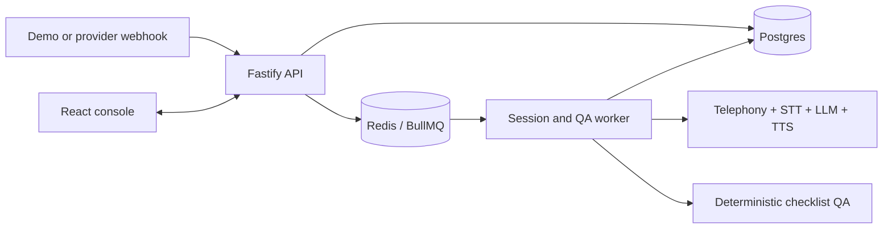

# open-bpo

[](https://github.com/nitturkaryash/open-bpo/actions/workflows/ci.yml)
[](LICENSE)
[](https://github.com/nitturkaryash/open-bpo/stargazers)
[](CONTRIBUTING.md)

**Open-source AI call centre: run an AI BPO floor on your laptop in one afternoon.**

open-bpo is a self-hostable scaffold for mock voice sessions, deterministic checklist QA, and call operations. The default path needs no paid API keys: Fastify accepts demo calls, BullMQ workers process sessions and QA, Postgres stores results, and a React console shows the floor.

> **Demo GIF placeholder:** add an authentic recording of the local golden path here. No screenshot or demo is included until it has been captured from a running build.

## Why open-bpo

Voice-agent demos often stop at a conversation. A BPO floor also needs queues, session state, repeatable QA, operational APIs, and a console. open-bpo keeps those pieces small enough to understand and replaces external services with mocks, so a developer can run and change the complete path locally before connecting real providers.

## Features

- Inbound and outbound mock call simulation
- Fastify API and BullMQ session/QA workers
- Deterministic, versioned checklist scoring with fatal checks
- React operations console for calls, sessions, traces, and QA breakdowns
- Swappable telephony, STT, TTS, and LLM interfaces
- Filesystem recipes for prompts, tools, and QA policy
- Local Redis and Postgres stack through Docker Compose
- No-key golden-path script suitable for local smoke tests

## Architecture



The provider boundary and runtime flows are described in [docs/ARCHITECTURE.md](docs/ARCHITECTURE.md).

## Three-command quickstart

Requirements: Docker with Compose and ports `4017`, `43123`, `55432`, and `56379` available.

```bash
git clone https://github.com/nitturkaryash/open-bpo.git
cd open-bpo
docker compose up --build
```

Open the console at [http://127.0.0.1:43123](http://127.0.0.1:43123), or create a call from another terminal:

```bash
curl -X POST http://127.0.0.1:4017/v1/demo/calls/inbound \
  -H "Content-Type: application/json" \
  -d '{"recipeId":"lead-qualification","provider":"mock","startSession":true}'
```

Run the complete API-to-QA smoke path with `./scripts/demo-golden-path.sh`. See [docs/QUICKSTART.md](docs/QUICKSTART.md) for the walkthrough.

## Develop locally

```bash
pnpm install
pnpm typecheck
pnpm test
pnpm build
```

The repository uses pnpm 10 and Node.js 22. The root scripts cover all workspaces; `pnpm build` creates the web production bundle, while the API and worker run TypeScript directly with `tsx`.

## Recipes and providers

Each directory under `recipes/` contains a prompt, tool declarations, and a deterministic checklist. Included examples cover lead qualification, support resolution, and payment reminders.

- [Provider integration guide](docs/PROVIDERS.md)
- [Recipe authoring guide](docs/RECIPE_AUTHORING.md)
- [QA checklist examples](docs/QA_CHECKLISTS.md)
- [API reference](docs/API_REFERENCE.md)

## Repository layout

```text
apps/api       Fastify API
apps/worker    BullMQ consumers
apps/web       React/Vite operations console
packages/core  shared session contracts and loop primitives
packages/qa    deterministic checklist schema and scorer
packages/providers  provider interfaces and mock/stub adapters
recipes        prompts, tools, and QA checklists
```

## Roadmap and contributing

The [roadmap](ROADMAP.md) lists scoped starter issues and larger production-readiness work. Contributions are welcome; read [CONTRIBUTING.md](CONTRIBUTING.md), use the issue templates, and keep the no-key mock path working. Security reports belong in [SECURITY.md](SECURITY.md), not a public issue.

If this scaffold saves you time, [star the repository](https://github.com/nitturkaryash/open-bpo) so other call-operations developers can find it.

## Production help

Want this in production? [QualiaBits runs it for BPOs](https://calendly.com/nitturkaryash/30min) through CallPulse.

## License

Apache-2.0. See [LICENSE](LICENSE).
